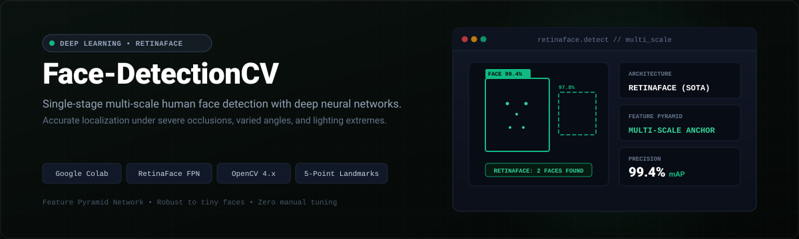
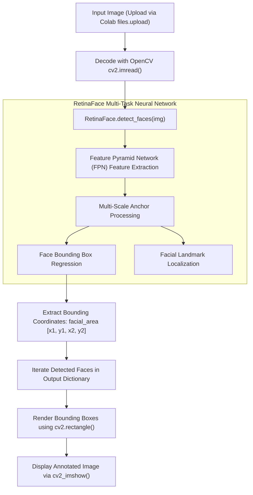

<p align="center">
  
</p>

<p align="center">
  <a href="https://colab.research.google.com/github/dipzz0/Face-detectionCV/blob/main/Face-detection.py" target="_blank">
    
  </a>
  
  
  
  
</p>

---

## ⚡ Overview

**Face-detectionCV** is a state-of-the-art computer vision application leveraging **RetinaFace**, a robust single-stage multi-task deep neural network designed for high-precision human face localization.

Unlike classical Haar cascades or standard HOG detectors, RetinaFace excels at localizing faces of extreme scales (from tiny distant faces to full-frame closeups), severe angles, heavy occlusions (masks, sunglasses, hats), and poor lighting conditions.

---

## 🚀 Key Features

- **🏆 State-of-the-Art (SOTA) Accuracy:** Employs RetinaFace with a Feature Pyramid Network (FPN) backbone for multi-scale spatial resolution.
- **🔍 Multi-Scale & Small Face Detection:** Capable of detecting tiny and distant faces in crowded scenes without degradation in accuracy.
- **📍 Precise Facial Area Localization:** Returns exact `[x1, y1, x2, y2]` spatial coordinates corresponding to `facial_area` bounding boxes.
- **⚡ Google Colab Integration:** Ready-to-run interactive image upload workflow using `google.colab.files` and rendering with `cv2_imshow()`.
- **🛡️ Occlusion Robust:** Maintains detection reliability even when subjects wear masks, glasses, or are turned sideways.

---

## 🎮 Workflow & Detection Pipeline



---

## 💻 How to Run in Google Colab

1. **Open the Script:**  
   Click the **"Open In Colab"** badge above or visit [Google Colab](https://colab.research.google.com).

2. **Run the Code Cell:**  
   Execute the cell to install `retina-face` and `opencv-python-headless`.

3. **Upload an Image:**  
   When prompted, choose any image from your computer (single person, family photo, or crowded street).

4. **Instant Detection:**  
   RetinaFace processes the image and outputs the image with precise green bounding boxes highlighting every detected face.

---

## 🌐 Running Locally

To run the project on your local machine:

1. **Clone the repository:**
   ```bash
   git clone https://github.com/dipzz0/Face-detectionCV.git
   cd Face-detectionCV
   ```

2. **Install dependencies:**
   ```bash
   pip install retina-face opencv-python
   ```

3. **Run the script:**
   ```bash
   python Face-detection.py
   ```
   *(Note: For local execution, replace `cv2_imshow(img)` with `cv2.imshow('Faces', img)` and `cv2.waitKey(0)`).*

---

## 🛠️ Technology Stack

| Technology | Role | Description |
| :--- | :--- | :--- |
| **RetinaFace** | Face Detector | Deep learning single-stage multi-task face detector |
| **OpenCV** | Computer Vision | Image reading, array manipulation, and visual bounding box rendering |
| **TensorFlow / Keras** | Backend | Underpins RetinaFace deep learning inference weights |
| **Google Colab** | Execution Platform | Zero-config cloud environment |

---

## 📄 License

This project is licensed under the [MIT License](LICENSE).

---

<p align="center">
  <b>Developed with ❤️ by <a href="https://github.com/dipzz0">dipzz0</a></b>
</p>
